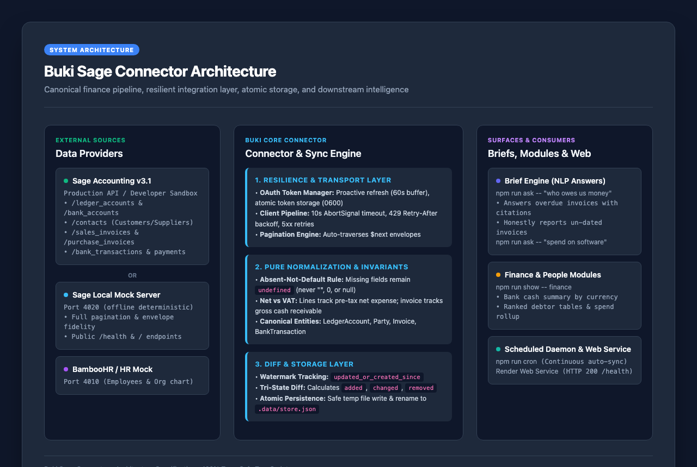
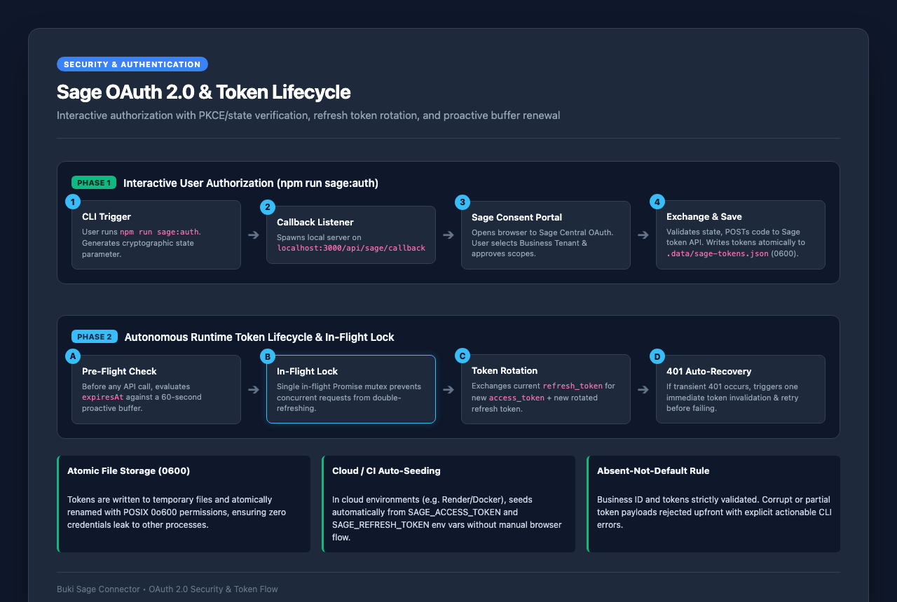

# Buki Sage Connector Architecture & Visual Guides

This document provides visual diagrams and architectural deep-dives for the Sage Accounting integration into Buki.

---

## 1. System Architecture

The connector bridges external accounting data from Sage Accounting API v3.1 (or local mock for deterministic offline execution) into Buki's canonical records, which feed the Brief engine and Finance module.

### Key Architectural Layers:

1. **Transport & Resilience Layer (`src/data/canonical/sage/client.ts`)**:
   - Strict 10-second request timeout (`AbortSignal.timeout(10_000)`).
   - HTTP 429 Rate Limit backoff parsing the `Retry-After` header.
   - Transient 5xx retries with exponential backoff and jitter.
   - Automatic envelope traversal following `$next` until exhausted.

2. **Pure Normalization & Canonical Invariants (`src/data/canonical/sage/normalize.ts`)**:
   - **Absent-Not-Default Rule:** Any field omitted by Sage (e.g. invoice `due_date`, contact `email`) remains `undefined` and is never converted to `""`, `0`, or `null`.
   - **Net vs. VAT Separation:** Pre-tax expenses/revenues are mapped to `InvoiceLine.net` so that category spend questions accurately represent economic costs. Gross amounts are mapped to `Invoice.total` and `Invoice.outstanding` for accurate cash and debtor calculations.
   - **Canonical Types:** Normalizes into `LedgerAccount`, `Party`, `Invoice`, and `BankTransaction`.

3. **Storage & Downstream Serving (`src/data/canonical/store.ts`, `src/lib/brief/answer.ts`)**:
   - Atomic file persistence: writes to temporary file then atomically renames to `.data/store.json`.
   - Downstream Brief engine (`npm run ask -- "<question>"`) and Finance module (`npm run show -- finance`) query canonical data with timestamped audit citations.

---

## 2. Authentication Flow & Token Lifecycle

Sage uses OAuth 2.0 with PKCE and state verification. The integration provides interactive developer authentication, token rotation, and runtime proactive refresh.

### Lifecycle Stages:

1. **Interactive CLI Authorization (`npm run sage:auth`)**:
   - Generates a cryptographically random `state` parameter.
   - Spawns a temporary local HTTP server on `http://localhost:3000/api/sage/callback`.
   - Opens the browser to Sage Central OAuth. The user logs in and grants consent to their Accounting trial business.
   - Sage redirects back to the local listener with `code` and `state`.
   - Verifies `state`, exchanges `code` for an access token (300s lifetime) and a refresh token (rolling 31-day lifetime).
   - Atomically saves tokens with POSIX `0o600` permissions (`.data/sage-tokens.json`).

2. **Proactive Runtime Token Refresh (`src/data/canonical/sage/auth.ts`)**:
   - Before any outgoing API request, checks the access token's `expiresAt` with a **60-second proactive buffer**.
   - An in-flight promise lock ensures concurrent API calls never initiate duplicate refresh requests.
   - Automatically rotates the refresh token when a new pair is issued.
   - If an unexpected 401 is received mid-request, triggers one immediate token recovery retry before surfacing an error.
   - **Cloud Environment Auto-seeding:** In cloud environments (e.g., Render), tokens auto-seed from `SAGE_ACCESS_TOKEN` and `SAGE_REFRESH_TOKEN` environment variables without requiring browser intervention.

---

## 3. Incremental Sync & Auto-Sync Engine

Syncing keeps Buki up-to-date with Sage continuously or on demand with zero downstream latency.

### How It Works:

1. **Triggering**:
   - Manual: `npm run sync` (one-off sync).
   - Continuous: `npm run cron` (scheduled daemon running every `SYNC_INTERVAL_SECONDS`, default: 300s).

2. **Incremental Fetching**:
   - Reads `last_sync_at` watermark timestamp.
   - Queries Sage endpoints with `updated_or_created_since=ISO8601`.
   - Follows pagination envelopes (`$next`) to guarantee complete record sets.

3. **Tri-State Diffing**:
   - Compares incoming normalized records against the existing store:
     - `added`: Records with new IDs.
     - `changed`: Existing records with modified content hashes (e.g., invoice marked paid).
     - `removed`: Records deleted at source.
   - Atomically writes to `.data/store.json`.

4. **Change Detection Walkthrough ("A change in Sage")**:
   - **Step A:** Invoice #1042 has `outstanding: $1,200`. The brief answers: *"$12,000 overdue across 4 clients"*.
   - **Step B:** Invoice is marked paid in Sage (or edited in `mock/sage/data/sage.json`).
   - **Step C:** Next cron sync tick detects the updated timestamp and diffs the record: `finance/sage: changed: 1`.
   - **Step D:** Re-asking *"who owes us money"* immediately reflects the change: *"$10,800 overdue across 3 clients"*, with updated audit timestamp.
