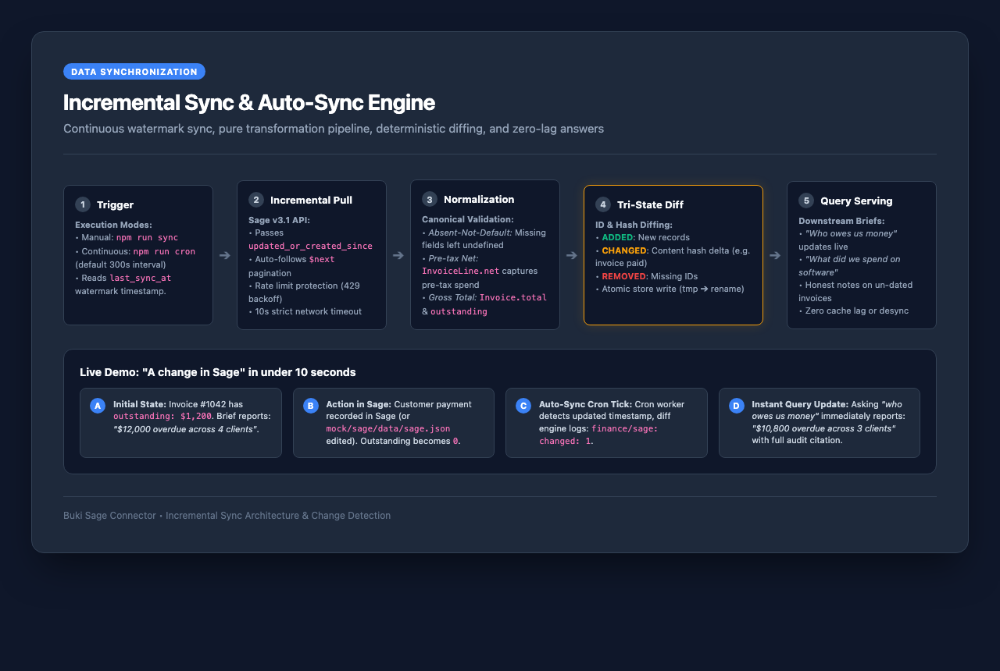

lik# Buki Sage Connector Architecture & Visual Guides

This document provides visual diagrams and architectural deep-dives for the Sage Accounting integration into Buki.

---

## 1. Connector Architecture (What We Built)

This diagram focuses directly on the connector components and code modules we implemented inside `src/data/canonical/sage/` and their integration seams with Buki's `FinanceProvider` contract:

### The 4 Built Submodules:

1. **Auth & Token Engine (`src/data/canonical/sage/auth.ts`, `authScript.ts`)**:
   - `npm run sage:auth` interactive CLI with local HTTP callback listener on port 3000.
   - Cryptographic state parameter CSRF verification & multi-business selection.
   - Proactive 60-second expiration renewal buffer with `refreshPromise` single-flight mutex lock.
   - Atomic token file storage using temporary file rename with POSIX `0o600` permissions.
   - Cloud environment auto-seeding from `SAGE_ACCESS_TOKEN` and `SAGE_REFRESH_TOKEN`.

2. **Resilient API Client (`src/data/canonical/sage/client.ts`, `raw/types.ts`)**:
   - Strict 10-second `AbortSignal.timeout(10_000)` on all network calls.
   - HTTP 429 rate limiter handling with `Retry-After` header inspection.
   - Transient 5xx retry with exponential backoff and randomized jitter.
   - Mid-flight 401 token invalidation & single-retry auto-recovery.
   - Generic `$next` pagination traverser (`listAll<T>`) for all Sage v3.1 envelopes.

3. **Pure Normalization Engine (`src/data/canonical/sage/normalize.ts`)**:
   - Enforces the strict **Absent-Not-Default Rule**: missing properties (`due_date`, `email`) remain `undefined` (never defaulted to `""`, `0`, or `null`).
   - **Net vs. VAT Separation**: `InvoiceLine.net` receives pre-tax `net_amount` for true expense analytics; `Invoice.total` & `outstanding` preserve gross cash obligations.
   - Invariant guarantees: void and paid invoices have `outstanding: 0`, and `outstanding <= total`.
   - Four pure transformers: `normalizeLedgerAccount`, `normalizeContact`, `normalizeInvoice`, and `normalizeBankTransaction`.

4. **Provider Seam & Mock Testing (`src/data/canonical/sage/provider.ts`, `mock/sage/`)**:
   - `SageFinanceProvider` implementing the canonical `FinanceProvider` contract: `health()` and `sync(options)`.
   - Registered at the provider seam in `src/data/canonical/providers/index.ts`.
   - Complete offline high-fidelity Sage Accounting v3.1 mock server (`mock/sage/server.mjs`) on port 4020 for deterministic local and cloud testing.
   - Unauthenticated `/health` and `/` endpoints answering HTTP 200 for deployment verification.

---

## 2. Authentication Flow & Token Lifecycle

Sage uses OAuth 2.0 with PKCE and state verification. The integration provides interactive developer authentication, token rotation, and runtime proactive refresh.

### Lifecycle Stages:

1. **Interactive CLI Authorization (`npm run sage:auth`)**:
   - Generates a cryptographically random `state` parameter.
   - Spawns a temporary local HTTP server on `http://localhost:3000/api/sage/callback`.
   - Opens the browser to Sage Central OAuth. The user logs in and grants consent to their Accounting trial business.
   - Sage redirects back to the local listener with `code` and `state`.
   - Verifies `state`, exchanges `code` for an access token (300s lifetime) and a refresh token (rolling 31-day lifetime).
   - Atomically saves tokens with POSIX `0o600` permissions (`.data/sage-tokens.json`).

2. **Proactive Runtime Token Refresh (`src/data/canonical/sage/auth.ts`)**:
   - Before any outgoing API request, checks the access token's `expiresAt` with a **60-second proactive buffer**.
   - An in-flight promise lock ensures concurrent API calls never initiate duplicate refresh requests.
   - Automatically rotates the refresh token when a new pair is issued.
   - If an unexpected 401 is received mid-request, triggers one immediate token recovery retry before surfacing an error.
   - **Cloud Environment Auto-seeding:** In cloud environments (e.g., Render), tokens auto-seed from `SAGE_ACCESS_TOKEN` and `SAGE_REFRESH_TOKEN` environment variables without requiring browser intervention.

---

## 3. Incremental Sync & Auto-Sync Engine

Syncing keeps Buki up-to-date with Sage continuously or on demand with zero downstream latency.

### How It Works:

1. **Triggering**:
   - Manual: `npm run sync` (one-off sync).
   - Continuous: `npm run cron` (scheduled daemon running every `SYNC_INTERVAL_SECONDS`, default: 300s).

2. **Incremental Fetching**:
   - Reads `last_sync_at` watermark timestamp.
   - Queries Sage endpoints with `updated_or_created_since=ISO8601`.
   - Follows pagination envelopes (`$next`) to guarantee complete record sets.

3. **Tri-State Diffing**:
   - Compares incoming normalized records against the existing store:
     - `added`: Records with new IDs.
     - `changed`: Existing records with modified content hashes (e.g., invoice marked paid).
     - `removed`: Records deleted at source.
   - Atomically writes to `.data/store.json`.

4. **Change Detection Walkthrough ("A change in Sage")**:
   - **Step A:** Invoice #1042 has `outstanding: $1,200`. The brief answers: *"$12,000 overdue across 4 clients"*.
   - **Step B:** Invoice is marked paid in Sage (or edited in `mock/sage/data/sage.json`).
   - **Step C:** Next cron sync tick detects the updated timestamp and diffs the record: `finance/sage: changed: 1`.
   - **Step D:** Re-asking *"who owes us money"* immediately reflects the change: *"$10,800 overdue across 3 clients"*, with updated audit timestamp.
